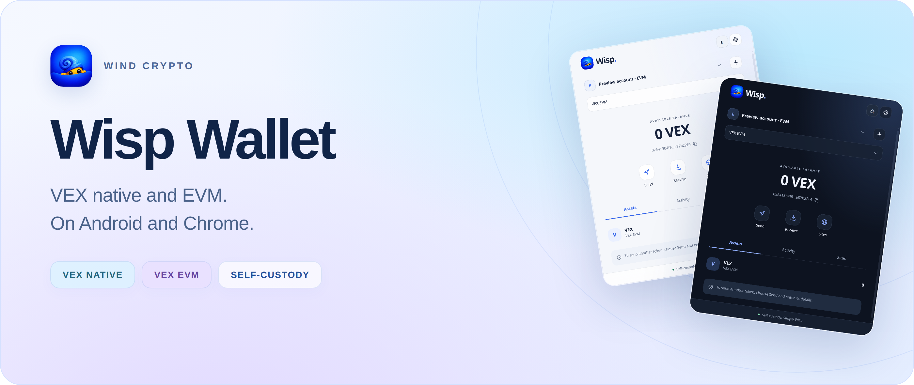
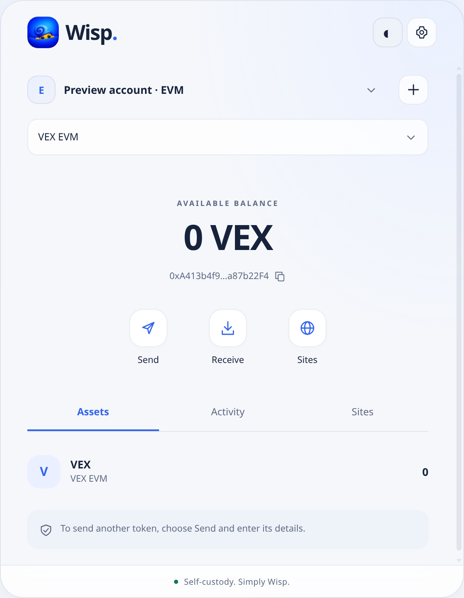
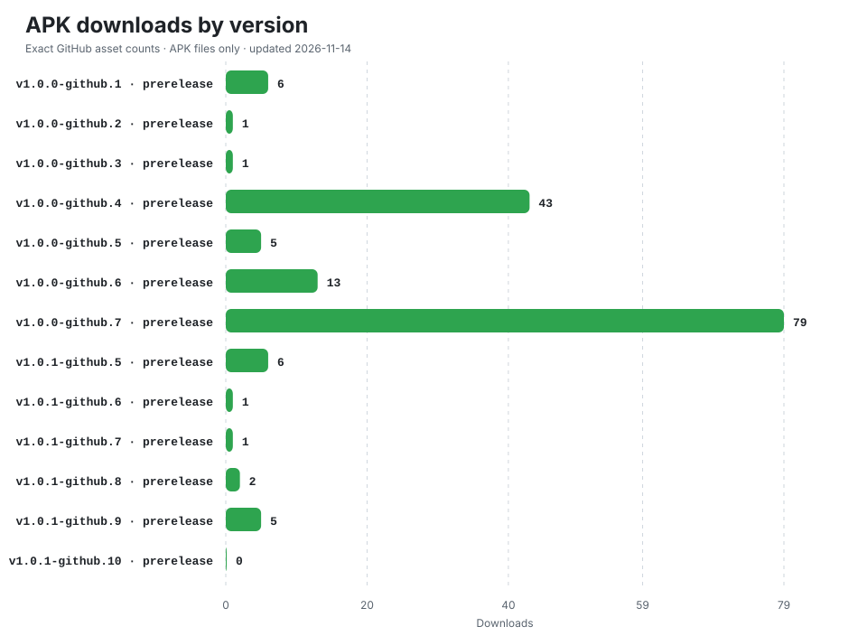

  <picture>
    <source media="(prefers-color-scheme: dark)" srcset="./assets/readme/hero-dark.png" />
    
  </picture>

  
  &nbsp;
  

  <a href="https://windcrypto.com/">Website</a> &nbsp;·&nbsp;
  <a href="https://github.com/windvex/wisp-wallet-releases/releases">All releases</a> &nbsp;·&nbsp;
  <a href="https://windcrypto.com/privacy/">Privacy</a>

## Your wallet, on Android and Chrome

Manage VEX native and EVM accounts, send and receive assets, and connect to DApps with Wisp. Review connections and transactions in your wallet before approving them.

| Android app | Chrome extension |
| :--- | :--- |
| **Stable release** | **Preview release** |
| A mobile wallet with a DApp browser and Vexanium resource management. | Accounts, transfers, DApp connections, and Vexanium resources in your browser. |
| [Download Android APK](https://github.com/windvex/wisp-wallet-releases/releases/latest) | [Download Chrome extension](https://github.com/windvex/wisp-wallet-releases/releases/tag/wisp-extension-v0.2.5) |

Android downloads are available as APK files for 64-bit devices. The Chrome preview is installed manually from the extension ZIP.

## Built around Vexanium

- **VEX native + EVM accounts.** Create or import accounts and switch between the networks you use.
- **Send and receive.** Transfer assets, share your receiving address, and follow transaction activity.
- **Connect to DApps.** Choose which sites can connect and review each signing request in your wallet.
- **Manage VEX resources.** Stake CPU/NET, use PowerUp, and manage RAM and REX.
- **Light and dark.** Choose the appearance you prefer on Android or in Chrome.

## A closer look

  <picture>
    <source media="(prefers-color-scheme: dark)" srcset="./assets/readme/wallet-dark.png" />
    
  </picture>

  Chrome extension · <a href="./assets/readme/wallet-light.png">Light view</a> &nbsp;·&nbsp; <a href="./assets/readme/wallet-dark.png">Dark view</a>

## Get started

### Android

1. Open the [latest Android release](https://github.com/windvex/wisp-wallet-releases/releases/latest) and download the `.apk` file.
2. Open the file on your phone and follow the installation prompts.
3. Open Wisp to create or import your accounts.

To update, install the newer APK over your existing installation.

### Chrome

1. Open the [Chrome release](https://github.com/windvex/wisp-wallet-releases/releases/tag/wisp-extension-v0.2.5) and download the file named `wisp-wallet-extension-*.zip`.
2. Extract it to a permanent folder.
3. Open `chrome://extensions` and enable **Developer mode**.
4. Select **Load unpacked**, choose the extracted folder, and pin Wisp to your toolbar.

To update, replace the files in the same folder and click **Reload** on Wisp. Keep the existing installation folder so Chrome can continue using its wallet data.

## Keep your accounts safe

Keep a backup for every account you want to recover. Never share your recovery phrase, private key, or wallet password in a support message.

Download Wisp from this repository's [official releases](https://github.com/windvex/wisp-wallet-releases/releases). Download checksums are included with the release files.

## Help and links

[Website](https://windcrypto.com/) · [Support](mailto:0xgvexa@gmail.com) · [Privacy](https://windcrypto.com/privacy/) · [Chrome privacy](https://link.windcrypto.com/extension/privacy/) · [Terms](https://windcrypto.com/terms/)

Android download history

 

[View download counts](./DOWNLOADS.md). Counts reflect APK downloads, not unique users or installations.

---

Wisp Wallet · Wind Crypto

